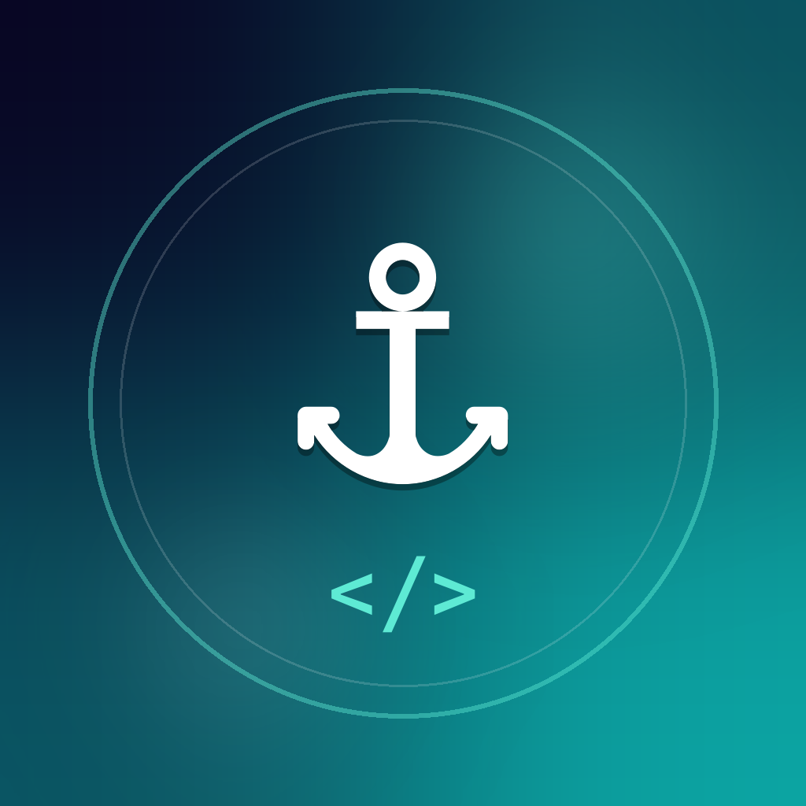
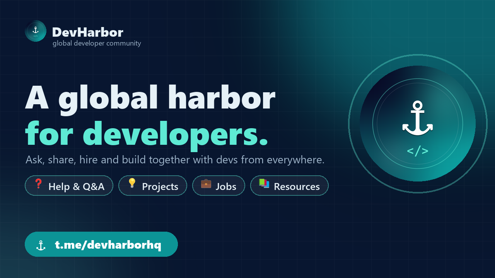
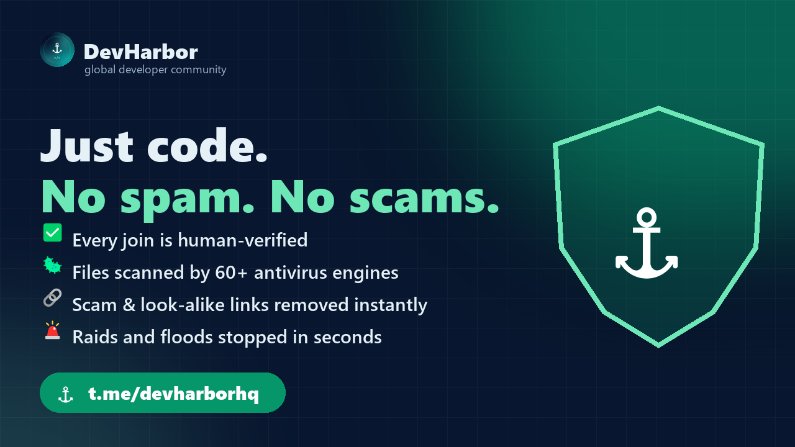

# DevHarbor

**A global harbor for developers.**

Ask questions, share projects, find jobs and build together with programmers from all over the world,
in a safe, moderated Telegram community.

🌍 Global · English &nbsp;·&nbsp; 🛡 Verified joins &nbsp;·&nbsp; 🦠 Malware-scanned files &nbsp;·&nbsp; 💸 Free forever

---

## Topics

| | |
|---|---|
| ❓ **Help & Q&A** | Stuck on a bug? Share the code and the full error, get answers fast. |
| 💡 **Projects** | Show what you're building: open source, side projects, experiments. |
| 💼 **Jobs** | Hiring or looking for work. Structured posts, no scams. |
| 📚 **Resources** | Tutorials, docs, courses and tools worth bookmarking. |
| ☕ **Off-topic** | Tech news, desk setups, memes. |
| 📣 **Announcements** | Official news, events and important changes. |

## Built to stay safe

Our own guard bot, **@DevHarborGuardBot**, protects every member:

- ✅ **Human check:** every join request passes a quick image check, so bots and spam accounts stay out.
- 🦠 **File scanning:** files are scanned by 60+ antivirus engines before anyone can download them.
- 🔗 **Link protection:** malicious, brand-new and look-alike scam sites are removed automatically.
- 🚨 **Spam & raid shield:** floods, scam messages and mass raids are stopped in seconds.

## Rules, in short

1. Be respectful. No harassment, hate speech or personal attacks.
2. English is the common language.
3. Use the right topic for your post.
4. No piracy: no cracks, keygens or illegally shared paid content.
5. No malware and no requests for "hacking tools".
6. No spam, scams, crypto pumps or unsolicited ads.
7. Share files through @DevHarborGuardBot so they can be scanned.
8. No shortened links. Post the full URL.
9. Don't DM members without their permission. Admins will never DM you first.

## Spread the word

Know a developer who'd like DevHarbor? Share the link or one of the cards in [`promo/`](promo/).

  
  

> 📌 **Always find your way back:** [the website](https://delilzagros.github.io/devharbor/) always shows the current
> link to the group. If it ever moves, the new link appears there and in the announcements channel first.

⚓ DevHarbor · run by <a href="https://github.com/delilzagros">Petrus</a>

